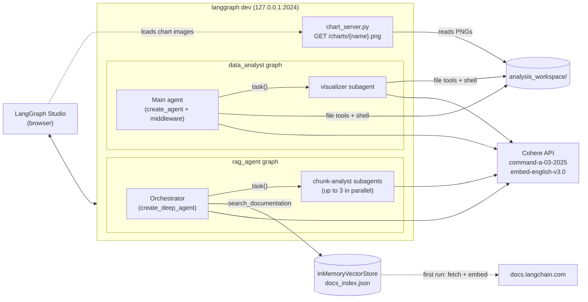

# Architecture

This document explains how the agents in this repo fit together and why they were built this way. For setup and run instructions, see [README.md](README.md).

## System overview



[langgraph.json](langgraph.json) registers both graphs and an extra HTTP app with one LangGraph dev server:

```json
"graphs": {
  "data_analyst": "./deep_agent_from_scratch.py:agent",
  "rag_agent":    "./rag_agent/rag_agent.py:agent"
},
"http": { "app": "./chart_server.py:app" },
"env": ".env"
```

Each module builds its graph at import time as a module-level `agent`, which is the form LangGraph expects. The same modules also have a `__main__` block, so each agent can run from the CLI without the server.

---

## Cross-cutting decisions

### ADR-1: Cohere as the only model provider

- **Decision:** Both agents use `ChatCohere(model="command-a-03-2025")`. The RAG agent also uses `CohereEmbeddings(model="embed-english-v3.0")`.
- **Why:** The upstream LangChain tutorials use Gemini, Claude and OpenAI. Using Cohere for both chat and embeddings means a new user needs only **one API key** (`COHERE_API_KEY`), and a free trial key is enough.
- **Trade-off:** The trial tier has tight rate limits (see ADR-2), and `langchain-cohere` has a streaming bug (see ADR-3).

### ADR-2: One shared client-side rate limiter per agent

- **Decision:** Each agent creates one `InMemoryRateLimiter(requests_per_second=15/60)`, which allows 15 requests per minute. The main agent and its subagents all use the same model instance and therefore the same limiter.
- **Why:** Cohere trial keys allow 20 chat requests per minute. Subagents (the visualizer, or up to 3 parallel chunk-analysts) call the model at the same time as the orchestrator. A single shared limiter caps their **combined** rate, and 15/min leaves headroom.
- **Trade-off:** The limiter only works within one process. Running the CLI scripts while `langgraph dev` is running, or using both graphs at once, can still exceed the limit. With a production key, raise or remove the limiter.

### ADR-3: Streaming disabled on the chat model

- **Decision:** `ChatCohere(..., disable_streaming=True)`.
- **Why:** In `langchain-cohere` 0.6.0, the streaming path crashes when Cohere leaves out billed token counts (`'NoneType' ... 'input_tokens'`). LangGraph Studio streams by default, so this bug would break the agents. Disabling streaming makes the model use the non-streaming path, which handles missing counts correctly.
- **Trade-off:** Studio shows each model response only once it's complete, not token by token. Graph-level events such as tool calls and subagent steps still stream.

### ADR-4: Configuration and secrets

- **Decision:** All secrets come from environment variables, loaded from a git-ignored `.env` with `python-dotenv` and through `"env": ".env"` in `langgraph.json`. The committed [.env.example](.env.example) is the template. Paths are resolved relative to each module file, so the scripts work from any working directory. Because of that, `rag_agent.py` explicitly loads `../.env`.
- **Keys kept away from the agent's shell:** The shell backends get `env={"PATH": os.environ["PATH"]}` and nothing else. If the model runs `env` or `printenv`, or reads `os.environ` from a script it wrote, it can't see `COHERE_API_KEY` or any other secret.
- **Other settings:** `CHART_BASE_URL` is optional and only needs changing if the dev server runs on a different host or port.

---

## Data Analyst agent ([deep_agent_from_scratch.py](deep_agent_from_scratch.py))

### ADR-5: Assembled from middleware instead of `create_deep_agent`

- **Decision:** The agent is built with `langchain.agents.create_agent` and an explicit middleware list, following the *Deep Agent from scratch* tutorial step by step:

  | Order | Middleware | Purpose |
  | --- | --- | --- |
  | 1 | `ChartDisplayMiddleware` (custom) | Shows newly created charts in the chat (ADR-8) |
  | 2 | `FilesystemMiddleware` | `ls`/`read_file`/`write_file`/`edit_file` plus `execute` (shell) |
  | 3 | `SummarizationMiddleware` | Compresses old history so long analyses stay within the context window |
  | 4 | `SkillsMiddleware` | Loads `SKILL.md` playbooks on demand (ADR-9) |
  | 5 | `TodoListMiddleware` | `write_todos` planning tool |
  | 6 | `SubAgentMiddleware` | `task()` tool to delegate to the `visualizer` |

- **Why:** Building it this way makes each capability visible and replaceable, which was the point of the lab. It also allowed a custom middleware to be added at a specific position.
- **Order matters:** `ChartDisplayMiddleware` comes first, so it removes chart-display messages before the other middleware (especially summarization) sends history to the model.

### ADR-6: Local shell backend instead of a remote sandbox

- **Decision:** `LocalShellBackend(root_dir=analysis_workspace/)`.
- **Why:** The tutorial uses a LangSmith sandbox, but sandboxes weren't enabled for the LangSmith org available. A local folder needs no extra account, and output files (scripts, charts, `report.md`) are easy to inspect.
- **Trade-off (important):** There is **no isolation**. File tools are limited to the workspace, but shell commands run on the host as the current user. Removing secrets from the shell environment (ADR-4) limits the damage, but this backend is only for local experiments. For anything shared or deployed, switch to a sandbox backend (LangSmith, Modal, Daytona or a container), which needs a change in `build_backend()` only.

### ADR-7: Prompt rules for paths and grounding

Two common failure modes were fixed in the system prompt instead of in code:

- **Two path styles:** File tools see the workspace as `/` (for example `/sales.csv`), while the shell runs *inside* the workspace and must use relative paths. `PATH_RULES` explains this and tells the model what to do when it sees "No such file": write the script first, and don't retry other paths.
- **Grounding:** The model must report only numbers that appear in tool output, and must change and rerun a script rather than guess. `CHART_RULES` treats IDs such as `Store` as categories, sorts bars, uses readable units, and asks the model to print the plotted values so the answer contains them as text, not only inside the image.

Both rule sets are shared by the main agent and the visualizer, because either one may end up drawing a chart.

### ADR-8: Showing charts in Studio (`ChartDisplayMiddleware` + `chart_server.py`)

**Problem:** The agent saves charts as PNG files on disk. Studio renders Markdown images but can't read local files.

**Design:**
1. `chart_server.py` is a small Starlette app, mounted on the dev server through `langgraph.json` → `http.app`. It serves `GET /charts/{name}.png` from `analysis_workspace/`.
   It only serves `.png` files that resolve to a path **inside** the workspace (`is_relative_to`), which blocks `../` path-traversal requests.
2. `ChartDisplayMiddleware`:
   - `before_agent` records when the turn started.
   - `after_agent` finds PNGs modified since then and adds one Markdown message that links them through `/charts/`. It also rewrites any `` the model wrote into a working URL, and reduces links to images that don't exist to their alt text.
   - URLs include `?v=<mtime>`, so the browser reloads a chart that was regenerated under the same name.
   - Chart messages are marked with `additional_kwargs={"chart_display": True}` and removed in `wrap_model_call`. They're for the person reading the chat, and the model never sees them, so they cost no tokens and don't confuse the model.
   - `aafter_agent` uses `asyncio.to_thread`, because the ASGI dev server doesn't allow blocking file I/O on the event loop.

### ADR-9: Skills loaded on demand

- **Decision:** At startup, playbooks under [skills/](skills/) (for example `pandas-patterns/SKILL.md`) are copied into the workspace at `/skills/`, and `SkillsMiddleware` is pointed at them.
- **Why:** The model sees only each skill's name and description until it decides to read the whole file. This keeps the system prompt short, and a new skill is just a new folder with a `SKILL.md`, with no code changes.

### ADR-10: `visualizer` subagent

- Charting is delegated to a subagent with its own prompt (matplotlib/seaborn, `bbox_inches='tight'`, print the plotted values). Its intermediate steps stay in its own context, and only its summary returns to the main agent.
- Subagent specs written as raw dicts get no tools by default, so the visualizer gets its own `FilesystemMiddleware` on the **same backend**. That way it reads the same CSVs and writes PNGs where `ChartDisplayMiddleware` looks for them.

### ADR-11: Sample data on startup

`upload_sample_data()` writes a small `/sales.csv` on every start, so the CLI demo always has the same input. Real analysis uses `Walmart_Sales.csv`, the only workspace file in git. Everything else the agent produces in `analysis_workspace/` is git-ignored.

---

## Docs RAG agent ([rag_agent/rag_agent.py](rag_agent/rag_agent.py))

### ADR-12: Retrieval results stored as files ("retrieve to filesystem")

- **Decision:** `search_documentation` doesn't return chunk text to the model. It writes the top `k=4` chunks to `/retrieved/<batch_id>/chunk_N.md`, each with a `# Source: <url>` header, and returns only the **file paths**.
- **Why:** The orchestrator's context stays small. Reading and summarising chunks is handed to `chunk-analyst` subagents, one per file, up to `max_concurrent_analysts = 3` in parallel. Each returns a summary of up to 300 words that includes the source URL. The orchestrator then combines the summaries into a cited answer, and searches again if they don't answer the question.
- **Backend:** `StateBackend` keeps these files in the graph state, not on disk. Retrieved chunks are temporary to each conversation, and this agent needs no shell.

### ADR-13: Workflow and safety rules in the prompt

- A fixed **Plan → Search → Analyze → Synthesize → Verify** loop. The agent must try at least 3 differently worded searches (using API terms, not the user's exact words) before saying the docs don't cover a question. It must search before answering, never answer from memory.
- **Prompt-injection defence:** Both the orchestrator and the chunk-analyst prompts say to treat retrieved documentation as *data* and ignore any instructions inside it.

### ADR-14: Building the index and caching it

- **Corpus:** 13 LangChain/LangGraph/Deep Agents doc pages, fetched as Markdown (`<url>.md`) from `docs.langchain.com`. Pages that fail to load are skipped, so one bad page doesn't stop startup.
- **Chunking:** `RecursiveCharacterTextSplitter(chunk_size=1000, chunk_overlap=200)`.
- **Store:** `InMemoryVectorStore`, which needs no database, saved to `rag_agent/docs_index.json` and reloaded on later starts.
- **Paced embedding:** The Cohere SDK sends all batches at once, which goes over the trial limit of 100k embedding tokens per minute. `add_documents_paced()` sends batches of about 20k tokens (estimated at 3 characters per token, which is conservative for code-heavy docs) and sleeps so the rate stays around 70k tokens per minute.
- **Trade-off:** Indexing runs at import time, so the first `langgraph dev` start waits a few minutes. The index file (~17 MB) is git-ignored and rebuilt on demand instead of committed. For a larger corpus, swap in a persistent vector store (Chroma, pgvector and so on). Only the `vector_store` construction would change.

---

## Sandbox coding agent ([Sandbox.py](Sandbox.py))

This is a minimal `create_deep_agent` with a `LocalShellBackend` on `agent_workspace/`. It uses the same restricted `PATH`-only shell environment and rate limiter as the other agents. Its prompt tells it to fix failing tests itself and rerun `pytest` until they pass, instead of describing a fix. It runs from the CLI only and isn't registered in `langgraph.json`.

---

## Known limitations and possible next steps

| Limitation | Possible improvement |
| --- | --- |
| Shell commands run on the host with no isolation | Use a sandbox backend (container, LangSmith, Modal or Daytona) |
| All threads share one `analysis_workspace/` | A workspace or sandbox per thread |
| Rate limiter only works within one process | A shared limiter (for example Redis), or a production Cohere key |
| RAG index is built at import time and blocks server startup | Build it in a separate `index` script or in CI, and use a persistent vector store |
| `CHART_BASE_URL` points to localhost | Use a relative URL or object storage for deployed servers |
| No automated tests for the agents | Add LangSmith evaluations (datasets of questions with expected answers) |
